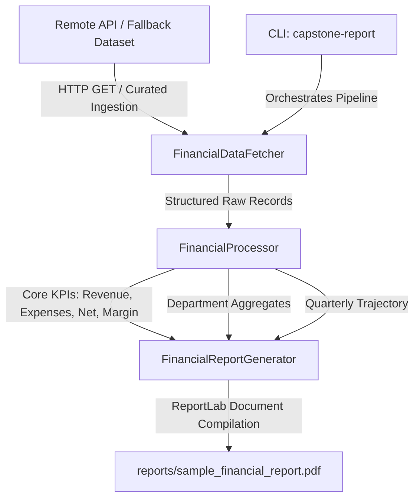

# Enterprise Python Automation Capstone Project (`capstone-engine`)

**Task 06: Enterprise Python Automation Capstone Project**  
*RabTech Python Software Engineering Internship*  
**Author:** Faizan Ali (`git.faizanali@gmail.com`)

---

## Overview

`capstone-engine` is an enterprise-grade automated business intelligence and financial reporting pipeline. It automates the end-to-end operational lifecycle:
1. **Dynamic Data Ingestion:** Fetches financial performance and departmental metric records across remote APIs with network fault tolerance and curated fallback data.
2. **Business Intelligence Analytics:** Computes key financial performance indicators (KPIs), including total revenue, expenditure, net profit, margin percentages, department contributions, and budget variances.
3. **Automated ReportLab PDF Publishing:** Generates publication-ready corporate PDF financial statements featuring branded headers, KPI metric cards, stylized data tables, and executive recommendations.
4. **Console Script CLI:** Features an intuitive command-line interface (`capstone-report`) for standalone or scheduled execution.

---

## Project Structure

```text
.
├── .gitignore
├── pyproject.toml
├── README.md
├── reports/
│   └── sample_financial_report.pdf
├── src/
│   └── capstone_engine/
│       ├── __init__.py
│       ├── fetcher.py
│       ├── processor.py
│       ├── pdf_generator.py
│       └── cli.py
└── tests/
    └── test_capstone.py
```

---

## Architecture & Data Flow



### 1. Ingestion Engine (`src/capstone_engine/fetcher.py`)
- Communicates with remote endpoints via `requests.get` with standard timeouts and custom client headers (`User-Agent: RabTech-Capstone-Engine/1.0`).
- Implements resilient error handling: automatically falls back to an enterprise dataset across 4 quarters and multiple departments if endpoints are offline.

### 2. Analytics Processor (`src/capstone_engine/processor.py`)
- Computes aggregated financial KPIs:
  - **Total Revenue:** Sum of all departmental income streams.
  - **Total Expenses:** Operational expenditures.
  - **Net Profit & Margin (%):** $\text{Net Profit} = \text{Revenue} - \text{Expenses}$; $\text{Margin} = (\text{Net Profit} / \text{Revenue}) \times 100$.
  - **Budget Variance:** Cumulative savings against budgeted allocations.
- Produces sorted department summaries and quarterly performance trajectories.

### 3. ReportLab Document Compiler (`src/capstone_engine/pdf_generator.py`)
- Utilizes ReportLab's **Platypus** framework (`SimpleDocTemplate`, `Paragraph`, `Table`, `Spacer`).
- **Corporate Visual Design:**
  - Executive Navy (`#1E3A8A`) and Teal (`#0F766E`) primary palette.
  - Stylized 2x4 Executive Summary KPI cards.
  - Zebra-striped data tables (`#F1F5F9`) with clear column alignment and currency formatting (`$XX,XXX.XX`).
  - Automated generation timestamp and strategic findings.

### 4. CLI Orchestration (`src/capstone_engine/cli.py`)
- Configured as an installed console script: `capstone-report`.
- Supports configurable output paths (`--output` / `-o`) and custom endpoints (`--endpoint` / `-e`).

---

## Installation & Setup

### 1. Create Virtual Environment
```bash
# Windows
python -m venv .venv
.venv\Scripts\activate

# Linux / macOS
python3 -m venv .venv
source .venv/bin/activate
```

### 2. Install Package in Editable Mode
```bash
# Windows
.venv\Scripts\python -m pip install --upgrade pip
.venv\Scripts\pip install -e ".[dev]"

# Linux / macOS
.venv/bin/python -m pip install --upgrade pip
.venv/bin/pip install -e ".[dev]"
```

---

## Usage Guide

### Generate Default Report
```bash
# Via console script
capstone-report

# Or via Python module directly
python -m capstone_engine.cli
```

### Custom Output Destination
```bash
capstone-report --output reports/annual_financial_audit.pdf
```

### Connect to Dynamic Remote Endpoint
```bash
capstone-report --endpoint "https://api.corporate.internal/v1/financials" --output reports/live_report.pdf
```

---

## Sample Report Metrics

Execution across default fiscal year data yields the following verified metrics:
- **Total Revenue:** `$17,120,000.00`
- **Total Expenses:** `$10,140,000.00`
- **Net Profit:** `$6,980,000.00` (40.77% profit margin)
- **Cumulative Budget Savings:** `$380,000.00`
- **Generated Document:** [`reports/sample_financial_report.pdf`](reports/sample_financial_report.pdf)

---

## Verification & Test Suite

All data ingestion, metric calculation, PDF generation, and CLI behaviors are verified with `pytest` and `pytest-cov`:

```bash
# Run unit tests with coverage
.venv\Scripts\python -m pytest -v
```

### Test Coverage Results
```text
============================= test session starts =============================
platform win32 -- Python 3.14.10, pytest-9.2.0, pluggy-1.7.0
rootdir: C:\Users\Aly\Desktop\RabTech\task6
configfile: pyproject.toml
testpaths: tests
plugins: cov-7.1.0
collected 8 items

tests/test_capstone.py::test_currency_formatter PASSED                   [ 12%]
tests/test_capstone.py::test_fetcher_default_data PASSED                 [ 25%]
tests/test_capstone.py::test_fetcher_remote_success PASSED               [ 37%]
tests/test_capstone.py::test_fetcher_remote_failure_fallback PASSED      [ 50%]
tests/test_capstone.py::test_processor_metrics_calculation PASSED        [ 62%]
tests/test_capstone.py::test_processor_empty_records_error PASSED        [ 75%]
tests/test_capstone.py::test_pdf_report_generation PASSED                [ 87%]
tests/test_capstone.py::test_pipeline_and_cli PASSED                     [100%]

=============================== tests coverage ================================
Name                                   Stmts   Miss  Cover   Missing
--------------------------------------------------------------------
src\capstone_engine\__init__.py            1      0   100%
src\capstone_engine\cli.py                40      4    90%   69-71, 75
src\capstone_engine\fetcher.py            23      3    87%   45-47
src\capstone_engine\pdf_generator.py      58      0   100%
src\capstone_engine\processor.py          43      0   100%
--------------------------------------------------------------------
TOTAL                                    165      7    96%
============================== 8 passed in 0.44s ==============================
```

- **All 8 tests passed (100%).**
- **Test coverage:** **96%**.
